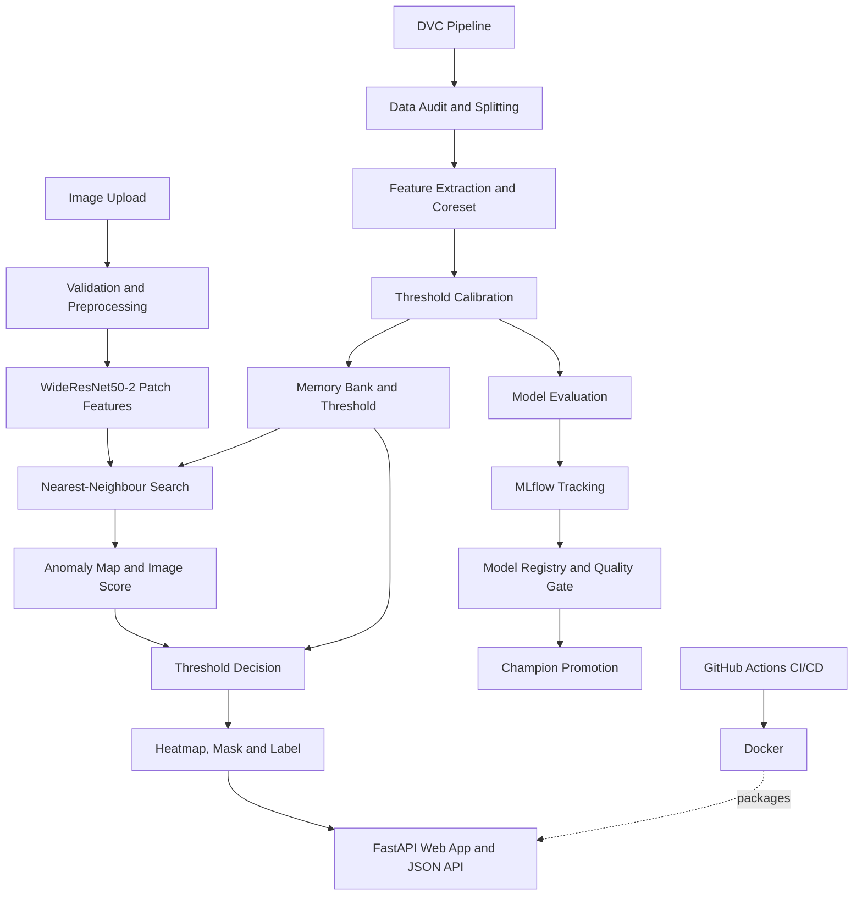

# DefectVision: Industrial Defect Detection with PatchCore

[](https://github.com/AmitKr-06/Industrial-defect-detection/actions/workflows/ci.yaml)

Unsupervised defect detection and localisation for metal nuts (MVTec AD, `metal_nut`). The model is trained on **normal parts only**. It flags defective parts and shows where the defect is, without ever seeing a defect during training.

The project covers the full path from raw data to a deployed service:

- a reproducible **DVC pipeline** (data audit, features, memory bank, threshold, evaluation)
- **MLflow** experiment tracking and a **model registry** with a quality gate and promotion rule
- a **FastAPI** service with a browser interface and a JSON API
- a **Docker** image, **GitHub Actions** CI/CD, and a pytest suite

## Architecture



The DVC pipeline builds the memory bank and threshold from normal images only. The web app does not train anything: it loads the memory bank and threshold (or the `champion` model from the registry) and scores each uploaded image.

## Layout

| Path | What it contains |
|---|---|
| `app/` | FastAPI service, templates, predictor |
| `src/` | ML core: data, features, model, pipeline, evaluation, tracking |
| `docker/` | `Dockerfile`, compose config, image requirements |
| `tests/` | pytest suite (scoring, validation, API) |
| `models/` | Inference artifacts — `memory_bank.pt`, `threshold.json` |
| `dvc.yaml` / `params.yaml` | Pipeline definition and all tunable values |
| `.github/workflows/` | `ci.yaml` (build + smoke) and `cd.yaml` (publish on tag) |

## Results

Evaluation on the 115 official test images (93 defective, 22 normal). The threshold comes from 22 held-out normal training images and does not use any test data.

| Metric | Value |
|---|---|
| Image AUROC | 0.9995 |
| Image average precision | 0.9999 |
| Pixel AUROC | 0.9888 |
| AUPRO (FPR ≤ 0.3) | 0.9380 |
| False positives / misses | 2 / 0 |
| Precision / recall / F1 | 0.979 / 1.000 / 0.989 |
| Mean Dice at the threshold (defective images) | 0.689 |
| Model latency (batch size 1, RTX 3050 Laptop GPU) | 30.4 ms |
| Peak GPU memory at inference | 417 MB |
| Memory bank size | 20,275 patches × 1024 (83 MB) |

Per defect type (each subset also contains all normal images):

| Defect | Image AUROC | Pixel AUROC | AUPRO |
|---|---|---|---|
| bent | 1.000 | 0.9960 | 0.9811 |
| color | 1.000 | 0.9952 | 0.9856 |
| flip | 1.000 | 0.9874 | 0.9580 |
| scratch | 0.998 | 0.9783 | 0.9260 |

Scratches are the hardest defect: they are thin, low contrast and cover little area. Metrics on the dev and final halves of the test set are in `reports/metrics/metrics_by_subset.csv`.

*AUPRO is computed with a dense threshold sweep. The earlier notebook implementation gave 0.9378. The two agree to 0.0002.*

## How it works

1. **Preprocessing.** Resize to 256×256 (bilinear, no cropping) and apply ImageNet normalisation. Masks use nearest-neighbour resizing so they stay binary.
2. **Features.** A frozen WideResNet50-2 (ImageNet weights) provides `layer2` (512×32×32) and `layer3` (1024×16×16). Both are averaged over a 3×3 neighbourhood, `layer3` is upsampled to 32×32, and they are concatenated and reduced to 1024 channels. Every image becomes 1024 patch vectors.
3. **Memory bank.** A greedy k-center **coreset** keeps the 10% most representative patches of the 198 training images (20,275 of 202,752). Distances are computed on a 128-dimensional random projection.
4. **Scoring.** Each test patch gets the distance to its nearest memory-bank patch. The 32×32 distance grid is upsampled to 256×256 and smoothed with a Gaussian (σ = 4). That is the **anomaly map**. The image score is its maximum.
5. **Decision.** An image is defective if its score exceeds the threshold (1.1666, the highest score among the 22 held-out normal images). Pixels above the threshold form the predicted defect mask.

No network is trained. "Fitting" the model means building the memory bank, which takes under a minute.

## Dataset and evaluation protocol

MVTec AD, category `metal_nut`: 220 normal training images, and 115 test images (22 normal, 93 defective: bent 25, color 22, flip 23, scratch 23), all 700×700 RGB with pixel-level masks.

| Role | Images | Used for |
|---|---|---|
| fit | 198 | building the memory bank |
| val_normal | 22 | choosing the threshold |
| test | 115 | final evaluation only |

The test set is also split once into a stratified **dev half (56)** and **final half (59)**, so that exploratory analysis can be separated from a final check. The split uses a fixed seed (42) and is saved to disk, so every stage sees the same images.

## Quick start

**Requirements:** Python 3.11, a CUDA GPU is recommended (tested on an RTX 3050 Laptop, 4 GB), Git, DVC.

```bash
git clone https://github.com/AmitKr-06/Industrial-defect-detection.git
cd Industrial-defect-detection

# PyTorch first (CUDA 11.8 build; use the CPU index if you have no GPU)
pip install torch==2.7.1 torchvision==0.22.1 --index-url https://download.pytorch.org/whl/cu118

pip install -r requirements.txt      # also installs the project itself (pip install -e .)
```

**Data.** Download the `metal_nut` category from the [MVTec AD website](https://www.mvtec.com/company/research/datasets/mvtec-ad) and place the archive at:

```
data/raw/metal_nut.tar.xz
```

**Run the whole pipeline** (a few minutes on a laptop GPU):

```bash
dvc repro
dvc metrics show
```

**Start the web app and API:**

```bash
uvicorn app.main:app --port 8000
```

Open http://127.0.0.1:8000, upload an image, or use the sample buttons.

### Quick start (Docker only — no Python needed)

If you just want to try the API:

```bash
docker run --rm -p 8000:8000 amiitkr/defectvision-api:v1.0.1
```

Then open http://localhost:8000 in your browser, or visit http://localhost:8000/docs for the Swagger UI.

## Reproducible pipeline (DVC)

`dvc.yaml` defines eight stages. Stages are skipped when their inputs, code and parameters have not changed.

| Stage | What it does | Main output |
|---|---|---|
| `data_ingestion` | Extracts the archive, builds the image table, audits the data (unreadable files, missing or orphan masks, size mismatches, label rules) | `data/processed/records.csv` |
| `data_splitting` | Creates the fit / val_normal / test roles and the dev / final halves | `data/processed/splits.csv` |
| `feature_extraction` | Extracts patch embeddings for the fit images | `data/interim/fit_embeddings.pt` |
| `memory_bank` | Greedy coreset selection, saves the bank | `models/memory_bank.pt` |
| `threshold_calibration` | Scores the validation-normal images and sets the threshold | `models/threshold.json` |
| `model_evaluation` | Image and pixel metrics on all / dev / final / per-defect subsets, latency benchmark, error figures, MLflow logging | `reports/metrics/metrics.json` |
| `model_registry` | Quality gate, then registers a new model version | `reports/metrics/registration_info.json` |
| `model_promotion` | Promotes the `champion` alias if the new version is good enough | `reports/metrics/promotion_info.json` |

All tunable values live in `params.yaml`. Changing one reruns only the affected stages.

`models/memory_bank.pt` and `models/threshold.json` are tracked in Git (not by DVC) so that CI can build the Docker image from them. After every retrain, commit both files.

## Experiment tracking and model registry (MLflow)

Every evaluation run logs all parameters, every metric (including per-subset metrics), the figures and the packaged model to MLflow. The model is registered as an MLflow `pyfunc` model that carries its own memory bank, threshold and settings.

| Step | Rule |
|---|---|
| Quality gate (before registering) | image AUROC ≥ 0.99, pixel AUROC ≥ 0.98, AUPRO ≥ 0.92, at most 3 misses |
| Registration | a new version gets the alias `staging` |
| Promotion | `staging` becomes `champion` if its AUPRO ≥ the current champion's − 0.005 (a tie promotes); otherwise it is kept as `candidate` |

Browse runs and versions:

```bash
mlflow ui --backend-store-uri sqlite:///mlflow.db
```

By default everything uses a local SQLite store (`mlflow.db`). To use a hosted MLflow server, create a `.env` file (never commit it):

```
MLFLOW_MODE=production
MLFLOW_TRACKING_URI=http://your-server:5000
MLFLOW_TRACKING_USERNAME=your_user      # only if the server requires authentication
MLFLOW_TRACKING_PASSWORD=your_password
```

The gate values, the tolerance and the model name are in the `mlflow` section of `params.yaml`.

## API and web app

| Endpoint | Method | Description |
|---|---|---|
| `/` | GET | Upload page with sample images |
| `/predict/view` | POST | Result page: original, heatmap overlay and flagged region, plus score statistics |
| `/predict` | POST | The same analysis as JSON |
| `/health` | GET | Service status, device, model source and version |
| `/info` | GET | Threshold, image size, model source and alias |
| `/heatmap/{id}` | GET | A generated PNG (original, overlay or mask) |
| `/docs` | GET | Interactive API documentation (Swagger UI) |

```bash
curl -F "file=@data/raw/metal_nut/test/bent/000.png" http://127.0.0.1:8000/predict
```

The JSON response contains:

| Field | Meaning |
|---|---|
| `score`, `threshold`, `ratio` | image anomaly score, decision threshold, and their ratio |
| `is_defective`, `label` | `true` and `DEFECTIVE` when the score exceeds the threshold |
| `area_pct` | percentage of the image above the threshold |
| `n_regions` | number of separate flagged regions (tiny noise regions are ignored) |
| `max_location` | `[row, col]` of the most anomalous pixel on the 256×256 map |
| `latency_ms` | model inference time |
| `original_url`, `heatmap_url`, `mask_url` | URLs of the generated images |

**Validation.** PNG, JPG and BMP files up to 10 MB are accepted. An unreadable or too small image (under 32 px per side) returns `400` with a message that is safe to show to a user. A wrong file type returns `415` and an oversized file `413`. Generated images are deleted after one hour.

**Model source.** By default the app loads `models/memory_bank.pt` and `models/threshold.json`. Set `MODEL_SOURCE=registry` to load the `champion` version from the MLflow registry instead (this needs `mlflow` installed and a reachable tracking server).

| Variable | Default | Purpose |
|---|---|---|
| `MODEL_SOURCE` | `local` | `local` or `registry` |
| `MODEL_NAME` / `MODEL_ALIAS` | `patchcore-metal-nut` / `champion` | registry model to load |
| `MLFLOW_TRACKING_URI` | empty | required for `registry` mode |
| `MAX_UPLOAD_BYTES` | 10485760 | upload size limit |
| `HEATMAP_TTL_SECONDS` | 3600 | lifetime of generated images |
| `API_HOST` / `API_PORT` | `127.0.0.1` / `8000` | used by `python -m app.main` |

## Docker

The image uses CPU-only PyTorch, the backbone weights are downloaded at build time (no internet needed at runtime), and the container runs as a non-root user with a health check.

```bash
docker compose -f docker/docker-compose.yml up --build
```

Then open http://127.0.0.1:8000. The compose file mounts `models/` read-only, so you can swap the model without rebuilding. Run the command from the repository root. CPU inference is slower than the GPU numbers above.

A published image is available on Docker Hub:

```bash
docker run --rm -p 8000:8000 amiitkr/defectvision-api:latest
# or pin a version:
docker run --rm -p 8000:8000 amiitkr/defectvision-api:v1.0.1
```

## CI/CD

- **CI** (`.github/workflows/ci.yaml`): on every push and pull request to `main`, builds the Docker image, starts the container and checks that `/health` answers.
- **CD** (`.github/workflows/cd.yaml`): when a tag such as `v1.0.0` is pushed, builds the image and pushes it to Docker Hub. Requires the repository secrets `DOCKERHUB_USERNAME` and `DOCKERHUB_TOKEN`.

```bash
git tag v1.0.0
git push origin v1.0.0
```

## Tests

```bash
python -m pytest tests -v
```

The suite checks:

- the scores and decisions of reference images against the notebook results
- that single-image scoring is deterministic and the same for file paths and uploads
- the output types and shapes
- that invalid input (text file, empty file, truncated image, tiny image) raises a user-safe error
- the API endpoints

The prediction tests need the artifacts produced by `dvc repro` and are skipped if they are missing.

## Configuration

The main settings in `params.yaml`:

| Parameter | Value | Meaning |
|---|---|---|
| `preprocessing.image_size` | 256 | input resolution |
| `feature_extraction.layers` | `[layer2, layer3]` | backbone layers used |
| `feature_extraction.pool_kernel` | 3 | local averaging window |
| `feature_extraction.embed_dim` | 1024 | channels per patch after reduction |
| `memory_bank.ratio` | 0.10 | fraction of patches kept by the coreset |
| `scoring.sigma` | 4.0 | Gaussian smoothing of the anomaly map |
| `scoring.aggregation` | `max` | how the map becomes an image score |
| `threshold.policy` | `max` | `max`, `mean_std` or `quantile` of the validation-normal scores |

## Experiments and ablations

These were run in the notebooks (single category, fixed settings, nothing tuned on the test set for the comparison). Differences below about 0.005 AUPRO are treated as ties.

**Model comparison** (same threshold rule for every model):

| Model | Image AUROC | Pixel AUROC | AUPRO | FP / FN | Latency | Stored size |
|---|---|---|---|---|---|---|
| PatchCore (this project) | 0.9995 | 0.9888 | 0.9378 | 2 / 0 | 30.4 ms | 83 MB |
| PaDiM-lite (100 dims) | 0.9721 | 0.9816 | 0.8996 | 3 / 10 | 9.6 ms | 41 MB |
| STFPM (ResNet-18, 1 seed) | 0.9888 | 0.9773 | 0.9420 | 2 / 1 | 6.3 ms | 22 MB |

PatchCore detects defects best at the image level (no misses). STFPM matches it on AUPRO (a tie by the rule above), is about five times faster and smaller, but was trained with a single seed. PaDiM-lite misses the most defects.

**PatchCore ablations** (one change at a time):

| Change | AUPRO | Verdict |
|---|---|---|
| reference | 0.9378 | |
| no Gaussian smoothing | 0.9386 | tie |
| image score = mean of top 1% pixels | 0.9378 | tie |
| random 10% bank instead of greedy (3 seeds) | 0.9341 ± 0.0002 | tie (slightly lower) |
| no coreset (full bank) | 0.9370 | tie, but 7× slower and 10× larger |
| all 1536 channels | 0.9378 | tie |
| layer2 only | 0.9568 | better, faster, half the memory |
| layer3 only | 0.9002 | worse |
| no local averaging (kernel 1) | 0.9446 | better AUPRO, lower pixel AUROC (0.9785) |

A hyperparameter study (bank ratio, smoothing, pooling kernel, input resolution) found that a higher resolution (384) improves AUPRO on the dev half (0.9543 vs 0.9309) but is about three times slower. The `layer2`-only variant improved AUPRO on both halves of the test set, but because those results were found on test data, it is documented as a candidate and not adopted as the default.

## Limitations

- **Single category.** Only `metal_nut` is trained and evaluated.
- **Small calibration set.** The threshold comes from 22 normal images. The 2 false positives on the test set (9% of normal parts) show that it is provisional, and it must not be read as a production false-alarm rate. A larger set of normal images, or an explicit false-alarm target, is needed before real use.
- **Test set reuse.** The official test set was used for exploratory comparison and ablations. The dev / final split reduces, but does not remove, the risk that the reported numbers are slightly optimistic.
- **Model comparison.** STFPM was trained with one seed, and image-level differences rest on only 22 normal test images.
- **Hardware.** Latency numbers are for a laptop GPU with batch size 1 and the model only (no upload or rendering time). They are not representative of other hardware.

## References

- Roth et al., *Towards Total Recall in Industrial Anomaly Detection* (PatchCore), CVPR 2022.
- Bergmann et al., *MVTec AD: A Comprehensive Real-World Dataset for Unsupervised Anomaly Detection*, CVPR 2019.
- Bergmann et al., *Uninformed Students: Student-Teacher Anomaly Detection with Discriminative Latent Embeddings* (source of the AUPRO metric), CVPR 2020.
- Wang et al., *Student-Teacher Feature Pyramid Matching for Anomaly Detection* (STFPM), 2021.
- Defard et al., *PaDiM: a Patch Distribution Modeling Framework for Anomaly Detection and Localization*, 2020.

## Licence and data

The MVTec AD dataset is licensed under CC BY-NC-SA 4.0 and is not redistributed in this repository. Using it with this project is limited to non-commercial purposes. Download it from the official MVTec website.